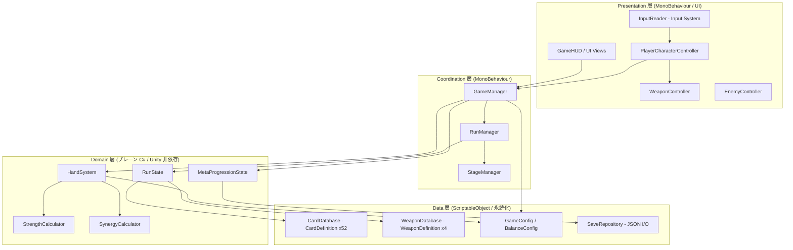

# 技術設計ドキュメント: Blackjack Roguelike

## Overview

本ドキュメントは、要件定義（`requirements.md`）に基づく「Blackjack Roguelike（仮称）」の技術設計を定義する。対象は Unity（2D / URP）で開発する横スクロール 2D アクションローグライクである。

設計の中核方針は **「ゲームロジックと Unity の実行時表現を分離する」** ことである。ブラックジャックの数値ロジック（Hand_Total 算出、Ace 可変、Bust 判定、Strength_Bonus 配分、Suit_Synergy、ラン進行、メタプログレッション）は MonoBehaviour に密結合させず、`UnityEngine` へ依存しないプレーン C# クラス（POCO）および ScriptableObject データで表現する。これにより以下を実現する。

- **テスト容易性**: 数値ロジックを EditMode テスト（Unity 非依存）で、特にプロパティベーステスト（PBT）で検証できる。
- **調整容易性**: 要件内で「DEFAULT（調整可能）」と注記された数値・ルール（Target_Value、各種係数、配分比率、ステージ数など）を ScriptableObject の設定アセットとして外部化し、コード変更なしでプレイテスト調整を可能にする。
- **責務の明確化**: 入力・物理・描画・UI は MonoBehaviour 側に、純粋な状態遷移と計算はロジック側に閉じ込める。

### 設計の主要な決定と根拠

| 決定 | 根拠 |
| --- | --- |
| ロジックをプレーン C# / ScriptableObject に分離 | PBT と EditMode テストを可能にし、Unity 実行環境なしで数値仕様を検証するため（要件 3・4・5 の数値不変条件が中心的価値を持つ） |
| カードは ScriptableObject の静的定義 + ランタイム状態のインスタンス | 52 種のカード定義をデータ駆動で管理し、エディタ上で編集可能にするため |
| 調整パラメータを `GameConfig` 系 ScriptableObject へ集約 | 「DEFAULT（調整可能）」要件（1.5, 3.1, 3.4, 3.6, 3.7, 7.2, 9.1, 12.2 ほか）に対応するため |
| 入力は Unity Input System（既存 `InputSystem_Actions.inputactions`） | ワークスペースに設定済みで要件前提。再バインド・デバイス非依存のため |
| メタプログレッション永続化は JSON シリアライズ + `Application.persistentDataPath` | 再起動後復元（要件 11.5）と破損検知を単純な手段で満たすため |

## Architecture

### レイヤ構成

本設計は 4 レイヤに分割する。依存は上位から下位への一方向のみを許す（下位は上位を知らない）。



### レイヤの責務

- **Presentation 層（MonoBehaviour）**: Unity の物理・入力・描画・UI。Domain 層の状態を読み取り表示し、入力を Coordination 層へ伝える。計算ロジックを持たない。
- **Coordination 層（MonoBehaviour）**: シーン上のオブジェクトのライフサイクル管理と、Presentation と Domain の仲介。イベントの購読・発火を担う。
- **Domain 層（プレーン C#）**: `UnityEngine` に依存しない純粋な状態と計算。Hand、Strength_Bonus、Bust、Synergy、Run 進行、Meta 状態。**PBT の主対象**。
- **Data 層（ScriptableObject / 永続化）**: 静的定義データと調整パラメータ、セーブ/ロード。

### イベント駆動による Presentation ↔ Domain の疎結合

Domain 層は C# の `event` / コールバック（または軽量なイベントバス）で状態変化を通知する。Presentation 層はこれを購読して UI を更新する。これにより Domain 層は Unity の UI 更新タイミング（要件 3.5, 4.4, 4.6 の「1000ms 以内」）を知らずに済む。UI 更新は購読側が次フレームで反映するため 1000ms 以内が保証される。

主要イベント:
- `HandChanged(HandSnapshot)` — Hand_Total 再計算時（要件 1.2, 1.3, 2.2）
- `StrengthBonusChanged(StatBreakdown)` — Strength_Bonus 変化時（要件 3.5）
- `BustStateChanged(bool isBust)` — Bust 突入/解除時（要件 4.4, 4.6）
- `BlackjackStateChanged(bool active)` — Blackjack 状態の有効/無効（要件 3.6, 3.7）
- `SynergyChanged(SynergyResult)` — Suit_Synergy 再算出時（要件 7.3, 7.4）

## Components and Interfaces

以下、各コンポーネントの責務とインタフェース概要を示す。`// Domain` はプレーン C#、`// MonoBehaviour` は Unity コンポーネント、`// ScriptableObject` はデータアセットを表す。

### Domain 層

#### HandSystem `// Domain`

Hand の管理と、合計・Bust・Strength_Bonus の算出の中心。要件 1・2・3・4・5・7 の数値仕様を担う。

```csharp
public sealed class HandSystem
{
    // 現在の手札（追加順を保持）
    IReadOnlyList<CardInstance> Hand { get; }

    int HandTotal { get; }          // 要件1.1: Ace を最適化した後の合計
    bool IsBust { get; }            // 要件4.1: HandTotal > TargetValue
    bool IsBlackjack { get; }       // 要件3.6: HandTotal == TargetValue

    event Action<HandSnapshot> HandChanged;
    event Action<bool> BustStateChanged;

    void AddCard(CardInstance card);        // 要件1.2 自動加入
    bool RemoveCard(CardInstanceId id);     // 要件1.3, 2.2 除去
    void SetEquippedWeaponSuit(Suit suit);  // 要件7.3

    StrengthResult EvaluateStrength();      // 要件3: Strength_Bonus と配分
    SynergyResult EvaluateSynergy();        // 要件7: Suit_Synergy
}
```

`HandSystem` は `BalanceConfig`（Target_Value・Max_Strength_Bonus・配分比率など）を注入して保持する。手札上限は設けない（要件 1.5）。

#### StrengthCalculator `// Domain`

Strength_Bonus の算出と各ステータスへの配分を行う純粋関数群。`HandSystem` から利用される。要件 3.2〜3.4, 3.6, 4.3 を担う。

```csharp
public static class StrengthCalculator
{
    // 要件3.2, 3.3: 0 <= HandTotal <= TargetValue で比例・単調増加、一致時に最大
    static int ComputeStrengthBonus(int handTotal, int targetValue, int maxStrengthBonus);

    // 要件3.4: 60/20/20 配分（比率は config から）
    static StatBreakdown Distribute(int strengthBonus, StatDistribution ratios);

    // 要件3.6: Blackjack 追加ブースト, 要件4.3: Bust_State の強化/デメリット
    static StatBreakdown ApplyBlackjackBoost(StatBreakdown b, float rate);
    static StatBreakdown ApplyBustModifier(StatBreakdown b, BustModifier mod);
}
```

#### SynergyCalculator `// Domain`

Suit_Synergy の算出（要件 7）。Equipped_Weapon の Weapon_Suit と一致する Card 枚数から強化量を求める純粋関数。

```csharp
public static class SynergyCalculator
{
    // 要件7.1, 7.2: 一致 Suit 枚数に応じた強化量（枚数比例、config 調整可能）
    static SynergyResult Compute(IReadOnlyList<CardInstance> hand, Suit weaponSuit, SynergyConfig config);
}
```

#### RunState / RunManager `// Domain + MonoBehaviour`

`RunState`（Domain）は 1 ランの状態（HP、Hand への参照、Equipped_Weapon、所持 Chip、進行中の Stage index、入手済みリソース）を保持。`RunManager`（MonoBehaviour）はシーン上の Stage 遷移・報酬提示・死亡/クリア判定を仲介する。要件 9・10 を担う。

#### MetaProgressionState `// Domain`

Run をまたぐ永続状態（Meta_Currency 残高、アンロック済み項目集合）。アンロック購入の検証と適用を行う。要件 11 を担う。`SaveRepository` と連携して永続化する。

### Coordination 層

#### GameManager `// MonoBehaviour`

アプリ全体のエントリポイント。起動時に `SaveRepository` から Meta_Progression を復元（要件 11.5）し、`GameConfig` を各 Domain オブジェクトへ注入。Domain のイベントを UI へ中継する。

#### StageManager `// MonoBehaviour`

Stage の生成・敵配置・地形配置・クリア判定（要件 9.2, 9.3）。全 Enemy 撃破で `StageCleared` を発火。

### Presentation 層

#### PlayerCharacterController `// MonoBehaviour`

横移動・ジャンプ・重力・接地判定・被弾を担う（要件 8.1, 8.2, 8.3, 8.6, 8.8）。`Rigidbody2D`（Dynamic, 重力スケール設定）と `Collider2D`、接地判定用の `GroundCheck`（オーバーラップ判定）を用いる。移動速度・攻撃力・最大 HP は Domain 層の `StatBreakdown` を購読して反映する。

```csharp
public sealed class PlayerCharacterController : MonoBehaviour
{
    void OnMove(Vector2 dir);     // Input System から
    void OnJump();
    void OnAttack();              // WeaponController へ委譲（要件8.4）
    void ApplyStats(StatBreakdown stats);  // Domain からの反映（要件3.4）
    void TakeDamage(int amount);  // 要件8.6, 10.2
    bool IsGrounded { get; }
}
```

#### WeaponController `// MonoBehaviour`

Equipped_Weapon の `WeaponDefinition`（Weapon_Suit とアクションパターン）に基づき攻撃挙動を実行（要件 6.4, 8.4）。命中時に現在攻撃力でダメージを与える（要件 8.5）。Suit_Synergy を攻撃パラメータへ反映（要件 7）。

#### EnemyController `// MonoBehaviour`

敵の AI・攻撃・被ダメージ・撃破（要件 8.5, 8.6, 9.2, 9.3）。

#### InputReader `// MonoBehaviour`

既存 `InputSystem_Actions.inputactions` をラップし、Move / Jump / Attack 等のアクションを C# イベントとして公開（要件 8.1, 8.2, 8.4, 8.7）。入力遅延は Update ループで即時反映し 100ms 以内を保つ（要件 8.7）。

#### GameHUD / UI Views `// MonoBehaviour`

Hand_Total・Target_Value・Strength_Bonus・HP・Bust 警告・Blackjack 状態・各 Ace の算入値・Weapon_Suit・Suit_Synergy を表示（要件 1.6, 3.5, 4.4, 4.6, 5.4, 6.5, 12.1〜12.5）。Domain イベントを購読して更新する。

### Data 層

#### CardDefinition `// ScriptableObject`

52 種のカードの静的定義。Suit, Rank, Card_Value（Rank から導出）、効果記述を保持。`CardDatabase`（ScriptableObject）が全 52 定義を束ねる。

#### WeaponDefinition `// ScriptableObject`

4 スートの武器定義。Weapon_Suit とアクションパターン（攻撃プレハブ/パラメータ）を保持。Card_Value を持たない（要件 6.3）。

#### GameConfig / BalanceConfig `// ScriptableObject`

「DEFAULT（調整可能）」パラメータを集約する調整アセット（詳細は Data Models 参照）。

#### SaveRepository `// Domain + Unity I/O 薄層`

Meta_Progression の JSON シリアライズ/デシリアライズと `persistentDataPath` への読み書き。破損検知・バックアップ復元を担う（要件 11.1, 11.5、エラーハンドリング参照）。

## Data Models

### 列挙型

```csharp
public enum Suit { Spade, Diamond, Club, Heart }

public enum Rank { Ace, Two, Three, Four, Five, Six, Seven, Eight, Nine, Ten, Jack, Queen, King }
```

### Card

```csharp
// ScriptableObject: 静的定義（52 種）
public sealed class CardDefinition : ScriptableObject
{
    public Suit Suit;
    public Rank Rank;
    public CardEffect[] Effects;   // 能力上昇・特殊効果（要件: カードは効果を付与）

    // Card_Value は Rank から導出（単一の真実の源）
    public int BaseCardValue => CardValueTable.Of(Rank);  // 2-10=額面, J/Q/K=10, A=11（可変は Hand 側で解決）
    public bool IsAce => Rank == Rank.Ace;                 // 要件5: Ace_Card
}

// ランタイム状態（手札に入った実体）
public sealed class CardInstance
{
    public CardInstanceId Id;      // 同一定義の複数所持と除去指定のための一意 ID
    public CardDefinition Definition;
}
```

`CardValueTable.Of(Rank)`: A→11（基準値。Hand 計算で 1/11 を最適化）、2〜10→額面、J/Q/K→10。これが要件内 Card_Value の定義の唯一の実装点であり、Hand_Total 算出が常にこの合計に一致する（Correctness Property 1 の基盤）。

### Weapon

```csharp
public sealed class WeaponDefinition : ScriptableObject
{
    public Suit WeaponSuit;                 // 要件6.1, 6.2
    public WeaponActionPattern ActionPattern; // 攻撃挙動（コンボ・射程・判定）
    // Card_Value は存在しない（要件6.3, 1.4）
}

public sealed class EquippedWeapon
{
    public WeaponDefinition Definition;
    public Suit Suit => Definition.WeaponSuit;
}
```

### Hand / 計算結果

```csharp
public readonly struct HandSnapshot
{
    public int HandTotal;              // Ace 最適化後
    public int TargetValue;
    public bool IsBust;
    public bool IsBlackjack;
    public IReadOnlyList<AceAssignment> AceAssignments; // 要件5.4: 各 Ace が 1 か 11 か
}

public readonly struct AceAssignment { public CardInstanceId Id; public int AssignedValue; } // 1 or 11

public readonly struct StrengthResult
{
    public int StrengthBonus;          // 0..MaxStrengthBonus
    public StatBreakdown Stats;        // 配分後
    public bool BlackjackActive;
    public bool BustActive;
}

public readonly struct StatBreakdown { public int Attack; public int MoveSpeed; public int MaxHp; }

public readonly struct SynergyResult { public bool Active; public int MatchingCount; public float Multiplier; }
```

### Run 状態

```csharp
public sealed class RunState
{
    public int CurrentHp;
    public int MaxHp;
    public HandSystem Hand;
    public EquippedWeapon Weapon;
    public int Chips;                  // Run 内一時通貨（要件: Run 終了で破棄）
    public int CurrentStageIndex;
    public int TotalStages;            // 既定 8（config、要件9.1）
    public RunResult Result;           // InProgress / Cleared / Dead
    public List<CardInstance> AcquiredThisRun;
    public List<WeaponDefinition> WeaponsThisRun;
}

public enum RunResult { InProgress, Cleared, Dead }
```

### Meta_Progression 状態

```csharp
[Serializable]
public sealed class MetaProgressionState
{
    public int MetaCurrency;                   // 要件11.1 永続
    public List<string> UnlockedIds;           // 購入済みアンロックの ID 集合（要件11.2, 11.3）
    public int SchemaVersion;                  // マイグレーション用
}

// 永続化用 DTO（JSON）
[Serializable]
public sealed class SaveData
{
    public int SchemaVersion;
    public MetaProgressionState Meta;
    public string Checksum;                    // 破損検知用（要件: エラーハンドリング）
}
```

### 調整パラメータ（ScriptableObject）

「DEFAULT（調整可能）」要件を外部化する。コード変更なしで値を変更でき、プレイテスト調整を可能にする。

```csharp
public sealed class BalanceConfig : ScriptableObject
{
    [Range(1, 99)] public int TargetValue = 21;            // 要件3.1
    public int MaxStrengthBonus = 100;                     // 要件3.3
    public StatDistribution StatRatios = new(0.6f, 0.2f, 0.2f); // 要件3.4（合計1.0制約）
    [Range(0f, 5f)] public float BlackjackBoostRate = 1.0f;     // 要件3.6（0-500%）
    public int BlackjackDurationMs = 5000;                 // 要件3.7（1-600000ms）
    public BustModifier BustMod;                           // 要件4.3（強化+デメリット）
    public int BustWarningMargin = 3;                      // 要件12.2
}

[Serializable] public struct StatDistribution { public float Attack, MoveSpeed, MaxHp; /* 合計=1.0 を検証 */ }

public sealed class SynergyConfig : ScriptableObject
{
    public float PerMatchingCardMultiplier = 0.1f;         // 要件7.2 枚数比例
}

public sealed class RunConfig : ScriptableObject
{
    public int StagesPerRun = 8;                           // 要件9.1
    public int CardRemovalChipCost = 10;                   // 要件2.3
    public int StartingHp = 100;                           // 要件10.1
    public WeaponDefinition StartingWeapon;                // 要件10.1
}
```

### Ace 可変と Bust 判定のアルゴリズム（疑似コード）

要件 1.1, 5.1〜5.3, 4.1 を実装する中心アルゴリズム。Ace を「バストしない範囲で最大」に自動選択する（要件 5.2）。

```
function ComputeHandTotal(hand, targetValue):
    nonAceSum = 0
    aceCount = 0
    for card in hand:
        if card.IsAce:
            aceCount += 1
        else:
            nonAceSum += CardValueTable.Of(card.Rank)   // 2-10 額面, J/Q/K=10

    // 全 Ace を一旦 1 として算入（最小構成）
    total = nonAceSum + aceCount * 1
    acesAsEleven = 0

    // バストしない範囲で、Ace を 1 つずつ 11 に昇格（+10）して合計を最大化
    // 各昇格は +10。total + 10 <= targetValue の間だけ昇格する（要件5.2, 5.3）
    remainingAces = aceCount
    while remainingAces > 0 and (total + 10) <= targetValue:
        total += 10
        acesAsEleven += 1
        remainingAces -= 1

    aceAssignments = []
    // 昇格した数だけ 11、残りは 1 として割り当て（表示用、要件5.4）
    assignElevenToFirst(hand, acesAsEleven, aceAssignments)

    return (total, aceAssignments)

function IsBust(handTotal, targetValue):      // 要件4.1
    return handTotal > targetValue
```

補足:
- Ace が 1 枚でも、`nonAceSum` が大きければ 11 に昇格できず 1 のまま。これにより「11 で超過するなら 1」（要件 5.3）が自動的に満たされる。
- Ace が複数枚でも、昇格は +10 単位で `targetValue` を超えない範囲まで貪欲に行う。各昇格が合計を増やし、かつ閾値を超えない限り最大化されるため「超えない範囲で最大」（要件 5.2）が成立する。
- 全 Ace を 1 にしてなお `total > targetValue` の場合は Bust（Ace では回避不能）。この場合 `acesAsEleven = 0` のまま Bust 判定へ流れる。

### Strength_Bonus 算出式（疑似コード）

要件 3.2〜3.4, 3.6, 4.3 を実装する。

```
function ComputeStrengthBonus(handTotal, targetValue, maxStrengthBonus):
    if handTotal <= 0:
        return 0
    if handTotal > targetValue:        // Bust 中は Strength_Bonus の比例算出を停止
        return 0                       // 強化は Bust_State 側の固定ブーストで扱う（要件4.3）
    // 0 <= handTotal <= targetValue: 比例・単調増加（要件3.2）
    bonus = round(maxStrengthBonus * (handTotal / targetValue))
    if handTotal == targetValue:       // 要件3.3: 一致時に最大
        bonus = maxStrengthBonus
    return clamp(bonus, 0, maxStrengthBonus)

function Distribute(strengthBonus, ratios):    // 要件3.4: 60/20/20（合計1.0）
    attack    = round(strengthBonus * ratios.Attack)     // 既定0.6
    moveSpeed = round(strengthBonus * ratios.MoveSpeed)  // 既定0.2
    maxHp     = round(strengthBonus * ratios.MaxHp)      // 既定0.2
    return StatBreakdown(attack, moveSpeed, maxHp)

function ApplyBlackjack(stats, active, boostRate):   // 要件3.6, 3.7
    if active:
        stats.Attack = round(stats.Attack * (1 + boostRate))  // 一時的追加ブースト
    return stats

function ApplyBust(stats, bustActive, bustMod):      // 要件4.3
    if bustActive:
        stats.Attack = round(stats.Attack * bustMod.AttackMultiplier)  // 強力な強化
        // デメリットは被ダメージ倍率として PlayerCharacter 側に伝達（即死はしない: 要件4.2）
    return stats
```

### Suit_Synergy 算出（疑似コード）

要件 7.1, 7.2 を実装する。

```
function ComputeSynergy(hand, weaponSuit, config):
    matching = count(card in hand where card.Definition.Suit == weaponSuit)
    active = matching >= 1                                  // 要件7.1
    multiplier = 1 + matching * config.PerMatchingCardMultiplier  // 要件7.2 枚数比例
    return SynergyResult(active, matching, multiplier)
```

## Correctness Properties

*A property is a characteristic or behavior that should hold true across all valid executions of a system — essentially, a formal statement about what the system should do. Properties serve as the bridge between human-readable specifications and machine-verifiable correctness guarantees.*

以下は、Domain 層の純粋ロジックに対してプロパティベーステスト（PBT）で検証する不変条件である。各プロパティは最低 100 回のランダム入力で検証する。UI 表示タイミング・物理挙動・シーン構成（Classification: EXAMPLE / INTEGRATION / SMOKE）はプロパティではなく、PlayMode テストまたは EditMode の例テストで扱う（Testing Strategy 参照）。

### Property 1: Hand_Total はカード Value の合計に一致する

*For any* 手札（任意枚数・任意ランク構成）について、`ComputeHandTotal` が返す Hand_Total は、算出された各 Ace 割り当て値と非 Ace カードの Card_Value を合算した値に正確に一致する。

**Validates: Requirements 1.1**

### Property 2: カード追加は手札を 1 枚増やし合計を再計算する

*For any* 手札と任意の追加カードについて、カード追加後の手札サイズは追加前 +1 であり、Hand_Total は追加後の全カードから一貫して再計算される（上限による拒否は発生しない）。

**Validates: Requirements 1.2, 1.5**

### Property 3: 追加・除去の round-trip は状態を復元する

*For any* 手札に対し、あるカードを追加してから同じカードを除去すると、手札の内容（Card_Value の多重集合）と Hand_Total は追加前と等価に復元される。

**Validates: Requirements 1.3**

### Property 4: 武器は Hand_Total に影響しない

*For any* 手札と任意の Equipped_Weapon の変更について、Weapon_Suit や装備武器をどのように変えても Hand_Total は不変である（武器は Card_Value を持たず合計対象外）。

**Validates: Requirements 1.4, 6.3**

### Property 5: 指定カードの除去は対象のみを取り除く

*For any* 手札と手札内の任意のカード ID について、その ID を除去すると当該 ID は手札から消え、他の全カードはそのまま残り、Hand_Total は残りカードから再計算される。

**Validates: Requirements 2.2**

### Property 6: 除去コストは残高が十分なときのみ消費される

*For any* Chip 残高とコストについて、残高がコスト以上なら除去は成立し残高はちょうどコスト分だけ減少する。残高がコスト未満なら除去は拒否され、手札と Chip 残高は不変のままである。

**Validates: Requirements 2.3, 2.4**

### Property 7: 合計を Target 以下へ戻すと Bust_State は解除される

*For any* Bust 状態の手札について、Card_Removal により Hand_Total を Target_Value 以下へ戻すと、Bust_State は解除され（IsBust=false）、Strength_Bonus の比例算出が再開して 0 以上の値を返す。

**Validates: Requirements 2.5, 4.5**

### Property 8: Strength_Bonus は Target 以下の範囲で単調非減少である

*For any* 2 つの Hand_Total h1, h2（0 ≤ h1 ≤ h2 ≤ Target_Value）について、`ComputeStrengthBonus(h1) ≤ ComputeStrengthBonus(h2)` が成り立ち、いずれの値も 0 以上 Max_Strength_Bonus 以下の範囲に収まる。

**Validates: Requirements 3.2**

### Property 9: Hand_Total が Target と一致すると Strength_Bonus は最大になる

*For any* Target_Value について、Hand_Total が Target_Value と等しいとき `ComputeStrengthBonus` は Max_Strength_Bonus を返す。

**Validates: Requirements 3.3**

### Property 10: Strength_Bonus の配分は比率に比例し総量を保存する

*For any* Strength_Bonus と合計 1.0 の配分比率について、攻撃力・移動速度・最大 HP への配分はそれぞれ `round(bonus × ratio)` に等しく、3 ステータスの合計は丸め誤差の範囲内で元の Strength_Bonus を保存する。

**Validates: Requirements 3.4**

### Property 11: Blackjack 状態は一致時に有効化され攻撃を倍率ブーストする

*For any* Target_Value と Blackjack_Boost_Rate について、Hand_Total が Target_Value と一致するとき Blackjack 状態が有効化され、ブースト後の攻撃力は `round(baseAttack × (1 + rate))` に等しい（rate=0 のとき攻撃力は不変）。

**Validates: Requirements 3.6**

### Property 12: Bust 判定は合計が Target を超えるとき、かつそのときのみ真である

*For any* Hand_Total と Target_Value について、`IsBust == (Hand_Total > Target_Value)` が成り立つ。

**Validates: Requirements 4.1**

### Property 13: Bust_State への遷移は即死を引き起こさない

*For any* Bust を誘発する手札について、Bust_State への遷移そのものによって Player_Character の HP が減少したり 0 以下になったりすることはない（遷移後も CurrentHp は遷移前と等しい）。

**Validates: Requirements 4.2**

### Property 14: Bust_State は強化とデメリットを同時に付与する

*For any* Bust 状態について、適用後の攻撃力は Bust モディファイアによって増加（倍率 ≥ 1）し、同時に被ダメージ倍率は 1 より大きくなる（強化とデメリットが共存する）。

**Validates: Requirements 4.3**

### Property 15: Ace の割り当て値は常に 1 または 11 である

*For any* Ace を含む手札について、算出された各 Ace の割り当て値は 1 または 11 のいずれかである。

**Validates: Requirements 5.1**

### Property 16: Ace は Target を超えない範囲で合計を最大化する

*For any* Ace を含む手札について、`ComputeHandTotal` が選ぶ Ace 割り当ては、Target_Value を超えない全割り当ての中で Hand_Total を最大化する割り当てに一致する。Target 以下にできる割り当てが存在しない場合は、Hand_Total を最小化する割り当て（全 Ace を 1）を選ぶ。

**Validates: Requirements 5.2, 5.3**

### Property 17: Suit_Synergy は一致カードが 1 枚以上あるとき、かつそのときのみ有効である

*For any* 手札と Weapon_Suit について、`Synergy.Active == (一致 Suit のカード枚数 ≥ 1)` が成り立つ。

**Validates: Requirements 7.1**

### Property 18: Suit_Synergy の強度は一致枚数について単調非減少である

*For any* 同一 Weapon_Suit と、一致枚数 m1 ≤ m2 を持つ 2 つの手札について、`SynergyMultiplier(m1) ≤ SynergyMultiplier(m2)` が成り立ち、強度は一致枚数に比例する。武器スートを変更した場合も、Synergy は新しい Weapon_Suit に対する一致枚数に基づいて再算出される。

**Validates: Requirements 7.2, 7.3, 7.4**

### Property 19: ダメージ適用は HP を 0 未満にしない

*For any* 現在 HP とダメージ量（および被ダメージ倍率）について、ダメージ適用後の HP は `max(0, hp − round(damage × multiplier))` に等しく、負値にはならない。同様に攻撃力に基づく敵へのダメージも `max(0, enemyHp − attack)` に等しい。

**Validates: Requirements 8.5, 8.6**

### Property 20: 操作受付可否は HP が正であることと一致する

*For any* 現在 HP について、`CanAcceptInput == (HP > 0)` が成り立つ。

**Validates: Requirements 8.8**

### Property 21: Stage クリア判定は全敵撃破と一致する

*For any* 敵の集合について、`IsStageCleared == (全ての敵の HP ≤ 0)` が成り立つ。

**Validates: Requirements 9.3**

### Property 22: Run クリアは最終 Stage 到達時のみ成立する

*For any* StagesPerRun と現在の進行度について、最終 Stage をクリアしたときのみ RunResult は Cleared になり、それ以前は InProgress である。

**Validates: Requirements 9.5**

### Property 23: Run 開始は状態を config の初期値へリセットする

*For any* RunConfig について、Run 開始後の RunState は HP = StartingHp、Hand は空、Equipped_Weapon = StartingWeapon、Chips = 0 となる（アンロック効果は反映済み）。

**Validates: Requirements 10.1**

### Property 24: HP が 0 以下になると Run は死亡終了する

*For any* 現在 HP について、HP ≤ 0 を適用すると RunResult は Dead になる。

**Validates: Requirements 10.2**

### Property 25: 死亡終了は Run 中の一時リソースを破棄する

*For any* Card・Weapon・Chip を入手した Run について、死亡終了処理後は入手カード集合が空、Chips = 0 となり、Run 一時リソースが破棄される。

**Validates: Requirements 10.3**

### Property 26: 付与される Meta_Currency は成果について単調非減少かつ非負である

*For any* 2 つの Run 成果（到達度 p1 ≤ p2）について、算出される Meta_Currency は `currency(p1) ≤ currency(p2)` を満たし、常に 0 以上である。

**Validates: Requirements 10.4**

### Property 27: Meta_Progression の保存・読込は round-trip で等価である

*For any* Meta_Progression 状態（Meta_Currency 残高とアンロック済み集合）について、シリアライズしてデシリアライズすると元の状態と等価な状態が復元される。

**Validates: Requirements 11.1**

### Property 28: アンロック購入は残高が十分なときのみ成立する

*For any* Meta_Currency 残高とアンロックコストについて、残高がコスト以上なら購入が成立し残高はコスト分減少し当該 ID がアンロック集合に追加される。残高が不足する場合は購入が拒否され、残高とアンロック集合は不変のままである。

**Validates: Requirements 11.2, 11.4**

### Property 29: アンロック済み効果は Run 開始時に反映される

*For any* アンロック済み集合を含む Meta_Progression について、Run 開始時の初期ステータスは当該アンロック効果（初期ステータス向上など）を反映した値になる。

**Validates: Requirements 11.3**

### Property 30: バスト警告は Target までの残りが閾値以内のとき発火する

*For any* Hand_Total・Target_Value・警告閾値 margin について、`ShouldWarn == (0 ≤ Target_Value − Hand_Total ≤ margin)` が成り立つ（Bust 済みは警告ではなく Bust 表示で扱う）。

**Validates: Requirements 12.2**

### Property 31: カード入手候補のプレビュー合計は実際の加入結果と一致する

*For any* 手札と候補カードについて、プレビュー表示用に計算される予測 Hand_Total は、その候補を実際に加入させたときの `ComputeHandTotal` の結果と一致する。

**Validates: Requirements 12.3**

## Error Handling

### セーブデータの破損・欠損（要件 11.1, 11.5）

- **破損検知**: `SaveData` に `Checksum`（例: シリアライズ本文のハッシュ）と `SchemaVersion` を含める。ロード時に Checksum を再計算して照合し、不一致なら破損とみなす。
- **復元戦略**: 書き込みは「一時ファイルへ書く → fsync → アトミックに本ファイルへリネーム」の手順で行い、書き込み途中のクラッシュによる本ファイル破損を防ぐ。加えて直前世代のバックアップ（`save.bak`）を保持し、本ファイルが破損していればバックアップから復元する。
- **両方破損／欠損**: いずれも読めない場合は、新規の初期 `MetaProgressionState`（Meta_Currency = 0、アンロックなし）を生成してゲームを継続する。進行は失われるがクラッシュはさせない。
- **スキーマ移行**: `SchemaVersion` が古い場合はマイグレーション関数を適用し、未知の新しいバージョンの場合は安全側に倒して初期状態で起動する。

### 不正なゲーム状態

- **設定値の検証**: `BalanceConfig` 読み込み時に不変条件を検証する。`TargetValue ∈ [1,99]`、`StatDistribution` の合計 = 1.0（許容誤差内）、`BlackjackBoostRate ∈ [0,5]`、`BlackjackDurationMs ∈ [1,600000]`。違反時はエディタ警告（`OnValidate`）とランタイムのクランプで安全な既定値に補正する。
- **除去対象の不在**: 存在しない `CardInstanceId` の除去要求は no-op として扱い、状態を変更せず false を返す（Property 5・6 の前提）。
- **Null / 未設定アセット**: `StartingWeapon` や `CardDatabase` の未設定は起動時アサーションで早期に検出し、プレイヤー操作前に明示的なエラーログで通知する。
- **Ace 回避不能な Bust**: 全 Ace を 1 にしてもなお超過する手札は正当な Bust として扱う（例外ではない）。Bust_State へ遷移し即死はしない（Property 13）。
- **負値ガード**: HP・ダメージ・通貨は `max(0, …)` で下限を保証し、負の残高やマイナス HP が発生しないようにする（Property 19・24）。

## Testing Strategy

本設計はロジックを Unity 非依存の Domain 層へ分離しているため、二層のテストアプローチを採る。

### プロパティベーステスト（PBT）— Domain 層

- **対象**: 上記 Correctness Properties（Property 1〜31）。Hand_Total 算出、Ace 最適化、Strength_Bonus 比例・配分、Bust/Blackjack 判定、Suit_Synergy、ダメージ計算、ラン進行、Meta 永続化 round-trip、バスト警告・プレビューなど、入力で挙動が変わる純粋ロジック。
- **ライブラリ**: C#/.NET 向けの既存 PBT ライブラリ（例: **FsCheck**、または **CsCheck**）を採用し、ゼロから実装しない。Unity Test Framework の EditMode テストから呼び出す（Domain 層は `UnityEngine` 非依存のため、Unity 実行環境なしでも実行可能）。
- **構成**:
  - 各プロパティは **最低 100 回**のランダム入力で実行する。
  - カスタムジェネレータを用意する: ランダムな手札（Ace を含む/含まない、大量枚数のエッジケースを含む）、ランダムな `BalanceConfig`（境界値 Target=1/99 等）、ランダムな Chip 残高・HP・敵集合・Meta 状態。
  - 各プロパティテストには設計プロパティへの参照コメントを付す。
  - タグ形式: **Feature: blackjack-roguelike, Property {番号}: {プロパティ本文}**

### ユニットテスト（例・エッジケース・エラー）— EditMode

- 具体例とエッジケースを少数補う（PBT が広い入力を担うため多用しない）:
  - Ace の代表例（A+K=21、A+A=12、A+9+K=20 など）。
  - 除去コスト不足の拒否、存在しない ID 除去の no-op。
  - セーブ破損時のバックアップ復元・初期化フォールバック。
  - 設定値クランプ（Target=0 → 1 に補正など）。

### PlayMode テスト — Presentation / Integration

プロパティ化に適さない UI タイミング・物理・シーン構成・入力レイテンシ（Classification: EXAMPLE / INTEGRATION / SMOKE）を 1〜3 例でカバーする:

- **UI 反映タイミング**（要件 3.5, 4.4, 4.6, 5.4, 12.1, 12.4, 12.5）: Domain イベント発火後 1000ms 以内に HUD が該当値を表示する。
- **Blackjack 持続**（要件 3.7）: Blackjack 有効化から Duration 経過後に無効化・ブースト解除。
- **入力レイテンシ**（要件 8.7）: 入力から画面反映まで 100ms 以内。
- **横スクロールアクション**（要件 8.1, 8.2, 8.3, 8.4, 6.4）: 移動・ジャンプ・接地・攻撃アクションの基本挙動。
- **ステージ/フロー**（要件 9.2, 9.4, 9.6, 10.5）: 敵・地形配置、クリア後の遷移・報酬・新 Run 提示。
- **永続化の再起動復元**（要件 11.5）: 保存 → 再ロード経路で Meta 状態が復元される。

### スモークテスト — データセットアップ（SMOKE）

- `BalanceConfig.TargetValue == 21`（要件 3.1）、`RunConfig.StagesPerRun == 8`（要件 9.1）。
- `WeaponDatabase` が Spade/Diamond/Club/Heart の 4 定義を持ち、各 `ActionPattern` が設定済みかつ相互に異なる（要件 6.1, 6.2）。
- `CardDatabase` が 4 スート × 13 ランク = 52 定義を持つ。

## Requirements Traceability

各 Requirement を設計のどのコンポーネントがカバーするかの対応関係。

| Requirement | 主担当コンポーネント | 検証（Property / その他） |
| --- | --- | --- |
| 1. カード自動加入と手札管理 | HandSystem, CardInstance, GameHUD | Property 1, 2, 3, 4 / UI は Example(1.6) |
| 2. カード除去（救済・調整） | HandSystem, RunState(Chips), Shop/RemovalUI | Property 5, 6, 7 / 手段提供は Example(2.1) |
| 3. Hand_Total による強化 | HandSystem, StrengthCalculator, BalanceConfig | Property 8, 9, 10, 11 / Smoke(3.1), Integration(3.5, 3.7) |
| 4. バスト時の挙動 | HandSystem, StrengthCalculator(ApplyBust), PlayerCharacterController | Property 12, 13, 14, 7 / Integration(4.4, 4.6) |
| 5. エース可変 | HandSystem(ComputeHandTotal), AceAssignment | Property 15, 16 / UI は Example(5.4) |
| 6. 武器のスート別アクション | WeaponDefinition, WeaponController, WeaponDatabase | Property 4(6.3) / Smoke(6.1, 6.2), Example(6.4, 6.5) |
| 7. 武器×カード シナジー | SynergyCalculator, HandSystem, WeaponController | Property 17, 18 / UI は Example(7.5) |
| 8. 横スクロール基本操作 | PlayerCharacterController, InputReader, WeaponController, EnemyController | Property 19, 20 / Example(8.1-8.4), Integration(8.7) |
| 9. 敵とステージ | StageManager, RunManager, EnemyController, RunConfig | Property 21, 22 / Smoke(9.1), Example(9.2, 9.4, 9.6) |
| 10. ローグラン構造と死亡・リセット | RunState, RunManager | Property 23, 24, 25, 26 / Example(10.5) |
| 11. メタプログレッション | MetaProgressionState, SaveRepository, GameManager | Property 27, 28, 29 / Integration(11.5) |
| 12. 状態の表示と可読性 | GameHUD, HandSystem(preview) | Property 30, 31 / Example(12.1, 12.4, 12.5) |

### 調整可能パラメータの外部化対応（DEFAULT（調整可能））

| 要件内の調整項目 | 外部化先 ScriptableObject フィールド |
| --- | --- |
| Target_Value（既定 21、1-99） | `BalanceConfig.TargetValue` |
| Max_Strength_Bonus | `BalanceConfig.MaxStrengthBonus` |
| ステータス配分 60/20/20 | `BalanceConfig.StatRatios`（合計 1.0 検証） |
| Blackjack_Boost_Rate（0-500%） | `BalanceConfig.BlackjackBoostRate` |
| Blackjack_Duration（1-600000ms） | `BalanceConfig.BlackjackDurationMs` |
| Bust_State の強化/デメリット内容 | `BalanceConfig.BustMod` |
| バスト警告マージン（既定 3） | `BalanceConfig.BustWarningMargin` |
| Suit_Synergy 枚数比例係数 | `SynergyConfig.PerMatchingCardMultiplier` |
| 1 Run あたり Stage 数（既定 8） | `RunConfig.StagesPerRun` |
| Card_Removal コスト | `RunConfig.CardRemovalChipCost` |
| 初期 HP / 初期武器 | `RunConfig.StartingHp` / `RunConfig.StartingWeapon` |
| メタアンロック項目・コスト | アンロック定義 ScriptableObject（`UnlockDefinition` データセット） |
