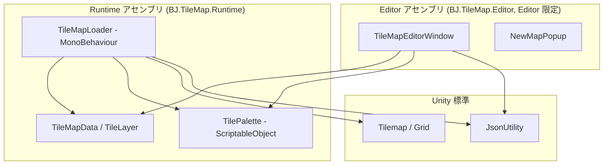

# 技術設計ドキュメント: TileMap Editor

## Overview

本ドキュメントは、要件定義（`requirements.md`）に基づく Unity 向けタイルマップエディタ拡張の技術設計を定義する。対象は Unity 6000.3.19f1（2D / URP）。

設計の中核方針は **「編集ツール（Editor）とゲーム実行時表現（Runtime）を分離する」** こと、および **「保存データは見た目を持たず、インデックスだけを持つ」** ことである。

- 保存データ（JSON）には「どのインデックスのタイルを、どのセルに置いたか」だけを記録する。
- 実際のスプライトは TilePalette が解決する。これにより、JSON を軽量・可読に保ち、見た目の差し替えをパレット側で完結できる。
- 描画先は Unity 標準の Tilemap とする。これにより将来、Tilemap に `TilemapCollider2D` を足すだけで当たり判定へ拡張できる。

### 設計の主要な決定と根拠

| 決定 | 根拠 |
| --- | --- |
| Runtime と Editor をアセンブリ分離 | Editor コードをビルドから除外し、Runtime をゲーム本体から利用可能にするため（要件 8） |
| 保存形式を JSON（JsonUtility） | 人間可読かつ Unity 標準 API で追加依存なく読み書きするため（要件 7.5） |
| タイルを TileIndex で保持し、見た目は TilePalette が解決 | JSON を軽量化し、スプライト差し替えを容易にするため（要件 1・7） |
| 描画先を Unity 標準 Tilemap | 将来の TilemapCollider2D による当たり判定拡張を見据えるため（将来拡張） |
| tiles を row-major の 1 次元配列 | JsonUtility が多次元配列を扱えないため、かつ可搬性のため（要件 7.2, 7.5） |
| layers を配列化（MVP は 1 枚） | 将来の複数レイヤー追加に備えるため（要件 7.3） |
| 編集 UI は IMGUI（EditorWindow + OnGUI） | Editor 拡張で実装が単純かつ安定しているため |

## Architecture

### レイヤ構成

本機能は Runtime と Editor の 2 アセンブリに分割する。依存は Editor → Runtime の一方向のみ。



### フォルダ構成

```
Assets/TileMapEditor/
├── Runtime/
│   ├── BJ.TileMap.Runtime.asmdef   … rootNamespace: BJ.TileMap
│   ├── TileMapData.cs              … TileMapData / TileLayer
│   ├── TilePalette.cs              … TilePalette (ScriptableObject)
│   └── TileMapLoader.cs            … TileMapLoader (MonoBehaviour)
└── Editor/
    ├── BJ.TileMap.Editor.asmdef    … Editor 限定, Runtime を参照
    └── TileMapEditorWindow.cs      … TileMapEditorWindow / NewMapPopup
```

## Components and Interfaces

### TileMapData / TileLayer（Runtime）

JSON とシリアライズ可能なプレーンデータ。JsonUtility 対応のため public フィールド + `[Serializable]`。

- `TileMapData`: `width`, `height`, `tileSize`, `paletteName`, `List<TileLayer> layers`
  - 定数 `EmptyTile = -1`
  - `CreateEmpty(width, height, tileSize)`: 全セル EmptyTile の 1 レイヤーマップを生成（要件 2.1, 2.2, 2.3）
- `TileLayer`: `name`, `collidable`（将来用, 要件 7.4）, `int[] tiles`（row-major, 要件 7.2）
  - `GetTile(x, y, w, h)` / `SetTile(x, y, w, h, value)`: 範囲外は無視/EmptyTile 返却（要件 3.4, 1.4）

### TilePalette（Runtime, ScriptableObject）

- `[CreateAssetMenu(menuName = "BJ/TileMap/Tile Palette")]`（要件 1.1）
- `Entry { displayName, sprite }` のリスト。登録順が TileIndex（要件 1.3）
- `GetSprite(index)`: 範囲外は null（要件 1.4）
- `CreateTile(index)`: スプライトから `Tile`（TileBase）を生成。呼び出し側でキャッシュ想定

### TileMapLoader（Runtime, MonoBehaviour）

- 入力ソース: `TextAsset jsonFile`（優先） / `string externalJsonPath`（絶対パス）
- `Load()`: ソースから JSON を読み `Render()`（要件 6.1）
- `Render(TileMapData)`: 各非 EmptyTile セルをパレット解決し Tilemap に設定（要件 6.2）
  - `Dictionary<int, TileBase>` でタイルをキャッシュ（要件 6.3）
  - Y 軸反転: `cellY = height - 1 - y`（要件 6.4）
  - targetTilemap / palette 未割り当て時はエラーログして中断（要件 6.5）

### TileMapEditorWindow（Editor, EditorWindow）

- メニュー `Window/BJ/TileMap Editor` で起動
- ツールバー: 新規マップ / 読み込み / 保存 / 名前を付けて保存 + dirty 表示（要件 2, 4, 5, 3.5）
- グリッド領域: セル描画 + グリッド線 + マウス入力処理（要件 3）
- サイドパネル: TilePalette 割り当て、消しゴム、タイル選択（要件 1, 3.3）
- `NewMapPopup`: 幅・高さ・タイルサイズの入力ダイアログ（要件 2.1）

## Data Models

### JSON 例

```json
{
  "width": 10,
  "height": 8,
  "tileSize": 16,
  "paletteName": "DefaultPalette",
  "layers": [
    {
      "name": "Ground",
      "collidable": false,
      "tiles": [ -1, 0, 0, 1, -1 ]
    }
  ]
}
```

- `tiles` の長さは `width * height`
- index = `y * width + x`（左上原点、行優先）
- 値は TileIndex。`-1` は空セル

## 座標系の扱い

| 空間 | 原点 | Y 方向 |
| --- | --- | --- |
| JSON / エディタ | 左上 | 下向きが増加 |
| Unity Tilemap | 左下 | 上向きが増加 |

TileMapLoader で `cellY = height - 1 - y` により一方向に変換する（要件 6.4）。

## Error Handling

- 読み込み失敗（パース不能・レイヤー 0）: ダイアログ表示、既存編集を保持（要件 5.2）
- 未保存での新規/読込: 破棄確認ダイアログ（要件 5.3）
- Loader の必須参照欠落: `Debug.LogError` で中断（要件 6.5）
- パレット未割り当て/範囲外 index: スプライト null → 描画スキップ（要件 1.4, 6.2）

## Testing Strategy

MVP は Editor 操作が中心のため、自動テストは任意。検証は主に手動の動作確認（`kirodata/TileMapEditor_操作マニュアル.md` の手順）で行う。

将来、Runtime ロジックに自動テストを追加する場合の候補:

- `TileLayer.GetTile/SetTile` の境界（範囲外、index 変換）ユニットテスト
- `TileMapData.CreateEmpty` のサイズ補正（要件 2.2）ユニットテスト
- JSON ラウンドトリップ（ToJson → FromJson で等価）テスト

## 将来拡張との接続点

| 将来機能 | 接続点 |
| --- | --- |
| 当たり判定 | `TileLayer.collidable` を Tilemap の `TilemapCollider2D` に反映 |
| 複数レイヤー編集 | `layers` は既に配列。Window にレイヤー選択 UI を追加 |
| 範囲選択・塗りつぶし | `HandleGridInput` に矩形/塗りつぶしモードを追加 |
| アンドゥ/リドゥ | 編集前の `tiles` スナップショットを履歴スタックで保持 |
